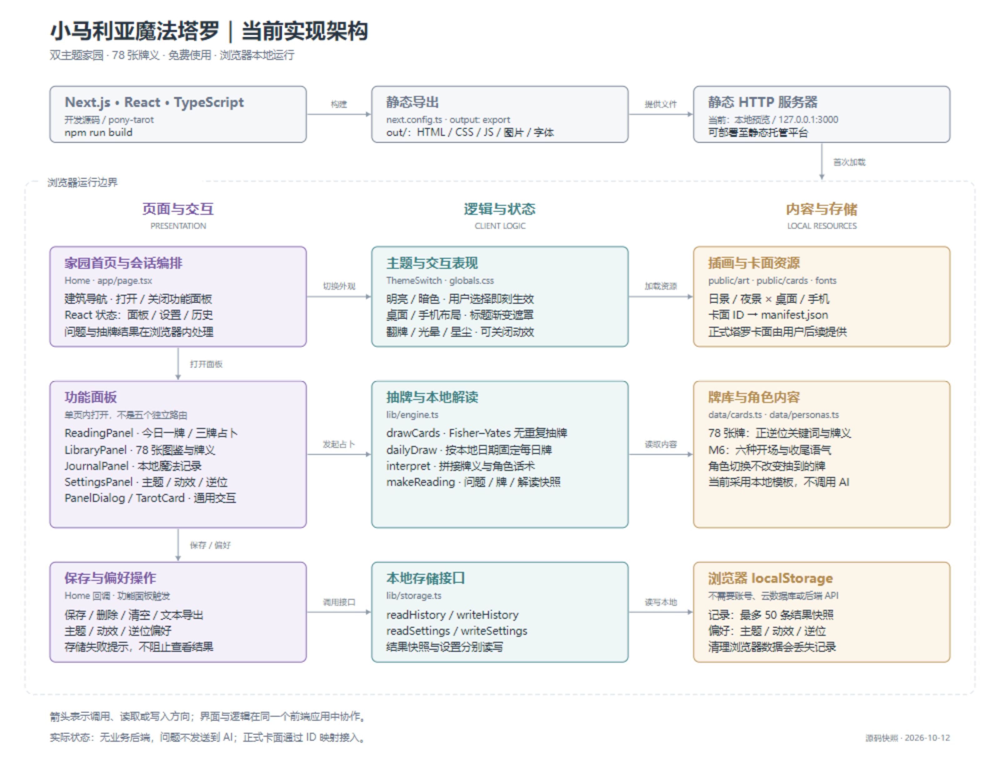
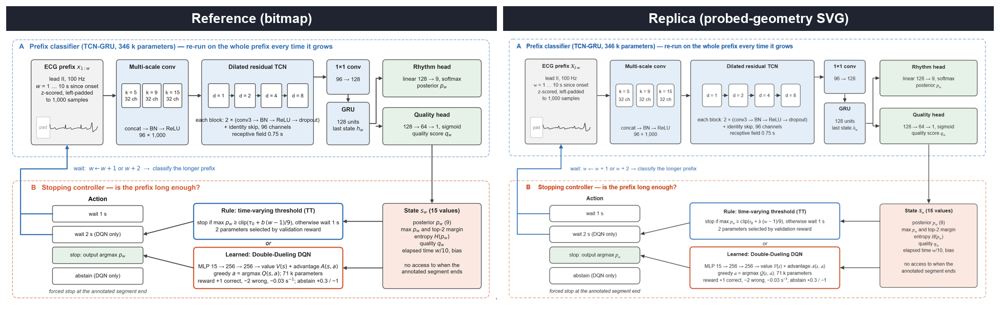
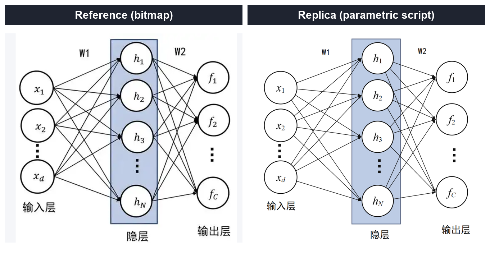
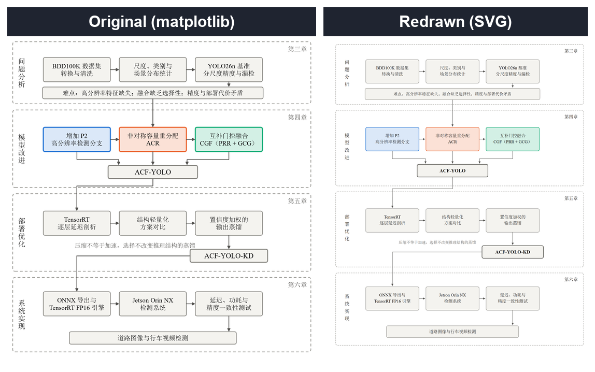

<div align="center">

🌐 本开源项目已链接并认可 <a href="https://linux.do/"><strong>LINUX DO</strong></a> 社区

</div>

---

<div align="center">

# 🎨 figcraft-skills

**Agent skills for publication-quality paper figures**
**让 AI Agent 稳定产出印刷级论文配图的技能包**

[](LICENSE)


*Probed-geometry SVG replication · Parametric diagram sources · Data-faithful re-renders · Visual-judge acceptance loop*

</div>

---

## Codex 完整流程与实战

新增 [Codex 制图指南](CODEX.md) 与 [codex-figure-workflow](skills/codex-figure-workflow/SKILL.md)：从项目事实梳理到参数化 SVG、浏览器导出和独立视觉验收。附 [小马宝莉塔罗网站实战](examples/pony-tarot/CASE.md)、可重生成图源和结果图。



## Why / 为什么

"Draw Figure 1 like the reference" is where AI agents usually produce something *almost* right — wrong fonts, drifting layouts, hand-moved data points, and no way to verify. This repo packages the workflow that fixes it:

**Four routes cover every figure type, one acceptance loop gates them all.**

"照着参考图画一张 Figure 1"是 AI 出图最容易翻车的任务——字体不对、布局漂移、数据点被手挪、还没法验证。本仓库把解决它的完整工作流打包成技能：

> **四条路线覆盖全部图型，一条验收闭环兜底。**

| | Reference → Replica | Reference → Replica |
|---|---|---|
| 📷 |  | |
| | *Bitmap reference → probed-geometry SVG (every box/text/arrow at probed coordinates)* | |

## The six skills / 六个技能

| Skill | Use when | What you get |
|---|---|---|
| [`codex-figure-workflow`](skills/codex-figure-workflow/SKILL.md) | End-to-end project diagrams in Codex | Source-backed structure → SVG/PNG → acceptance, with a real website case |
| [`game-arch-diagram`](skills/game-arch-diagram/SKILL.md) | **Software/game architecture figures** — layered bands, state machine, feedback loops | Design language (rider-chip band titles, semantic tints + accent bars, update-order badges, white-halo labels) + 6-defect collision catalogue from real judge rounds |
| [`hand-svg-structure`](skills/hand-svg-structure/SKILL.md) | Replicating a **bitmap** structure figure (block diagram / flowchart / network) | `probe_geometry.py` (connected-component boxes, ring-scan circles, text-row baselines, color extraction) + `prepare_export_pages.py` (tile-safe browser export pages) |
| [`parametric-diagram`](skills/parametric-diagram/SKILL.md) | Drawing a structure figure **from scratch** that will be revised | `make_fig.py` — geometry/topology/style declared in three blocks; the script is the single source of truth |
| [`data-figures-rerender`](skills/data-figures-rerender/SKILL.md) | **Data figures** (scatter/bar/slope) — points are real results | Re-render from the same frozen tables, encodings kept item-by-item; SVG + 600 dpi PNG; [`PITFALLS.md`](skills/data-figures-rerender/PITFALLS.md) with 10 field-tested traps |
| [`declarative-engine`](skills/declarative-engine/SKILL.md) | Grid-based block diagrams via a declarative layout engine | Config syntax + three real manuscript configs + no-download SVG extraction |
| [`visual-acceptance`](skills/visual-acceptance/SKILL.md) | **Before delivery, always** | Live-page screenshots, tiling self-check (`check_tiling.py`), vision-judge dispatch templates, evidence-driven fix discipline |

| 技能 | 何时用 | 产出 |
|---|---|---|
| `codex-figure-workflow` | Codex 从源码完成整套架构图 | 完整指南、参数化图源、结果图和验收实战 |
| `game-arch-diagram` | 软件 / 游戏架构图（分层带 + 状态机 + 反馈回路） | 设计语言七件套（骑缝标题牌 / 语义色浅底 / 色条 / 顺序徽标 / 白描边标签）+ 视觉裁判实战缺陷库 |
| `hand-svg-structure` | 复刻位图结构图（框图/流程/网络/示意） | 位图几何配色程序化探测 + 防平铺导出页工具 |
| `parametric-diagram` | 从零画会反复修改的结构图 | 参数化脚本即图源：几何/拓扑/样式三段声明，改声明重跑即再生 |
| `data-figures-rerender` | 数据图（散点/柱状/斜率）——点是真数据 | 同一批冻结表格重渲染，编码逐项保持；绝不手挪数据点 |
| `declarative-engine` | 网格型框图/网络总览/部署流程图 | 声明式引擎配置语法 + 三份真实论文图配置 |
| `visual-acceptance` | 交付前必过 | 活页面截屏、平铺自检、独立视觉裁判逐字对照、按像素证据修根因 |

Codex 新增组合入口：[codex-figure-workflow](skills/codex-figure-workflow/SKILL.md)，适用于基于实际项目制作结构图并完成整套交付。它复用以上路线，不替代它们。

## More before/after / 更多对比

<p>
  
  
</p>

*Left pair: textbook network figure — bitmap reference vs parametric-script replica (stacked arrowhead clusters, upright digit subscripts). Right pair: research roadmap — matplotlib original vs hand-authored SVG.*

## Results / 战绩

| Batch | Figures | Outcome |
|---|---|---|
| Journal manuscript figures (re-render) | 6 | 6/6 PASS, first round |
| Journal submission figures (7 + graphical abstract) | 8 | 8/8 PASS, first round |
| Thesis architecture figures (redrawn) | 11 | 11/11 PASS after 2 rounds |
| Single-figure replications (ECG pipeline, MLP) | 2 | PASS |
| Game architecture figure (design-polish rounds) | 1 | PASS after 2 judge rounds — 6 collision defects catalogued into [`game-arch-diagram`](skills/game-arch-diagram/SKILL.md) |

All accepted figures shipped as **SVG (vector) + 600 dpi PNG**, judge-verified string-by-string and arrow-by-arrow against their references.

所有通过验收的图均以 **SVG 矢量 + 600 dpi PNG** 交付，由独立视觉裁判逐字符串、逐箭头对照参考图后放行。

## Install / 安装到你的 Agent

Each folder under [`skills/`](skills/) is a self-contained skill in the common `SKILL.md` format (frontmatter + workflow). To use:

```bash
# Claude Code / ZCode — per project
cp -r skills/hand-svg-structure  .claude/skills/
# or globally
cp -r skills/hand-svg-structure  ~/.claude/skills/
```

Then just ask your agent: *"Replicate this reference figure as a print-quality SVG"* — the skill drives the workflow (probe → author → export → judge).

每个技能目录自带 `SKILL.md`（frontmatter + 工作流）与所需工具脚本，复制到 Agent 的技能目录即可被自动发现。数据图路线的 `load()` 需要对接你自己的冻结结果表。

## Tested with / 实测环境

The original paper cases were tested with **GLM-5.3-Flash** (ZCode). The added website architecture case was completed in **Codex desktop**. The workflow is model-agnostic.

原有论文案例由 **GLM-5.3-Flash**（ZCode）完成；新增网站架构图案例在 **Codex 桌面环境**完成。方法不绑定模型——具备文件读写、浏览器渲染与独立视觉检查能力的 Agent 均可使用。

## Repository layout / 目录

```
figcraft-skills/
├── skills/
│   ├── hand-svg-structure/     # probe tool + export pages + examples
│   ├── parametric-diagram/     # make_fig.py template + example
│   ├── data-figures-rerender/  # re-render template + PITFALLS.md
│   ├── declarative-engine/     # config syntax + manuscript configs
│   ├── visual-acceptance/      # check_tiling.py + judge templates
│   ├── codex-figure-workflow/   # Codex end-to-end entry
│   └── game-arch-diagram/      # architecture design language + defect catalogue
├── examples/pony-tarot/         # Codex case, sources, renders, evidence
├── CODEX.md                    # Codex workflow guide
├── assets/                     # before/after composites
├── METHOD.md                   # the 8 principles behind every route
└── LICENSE                     # MIT
```

Start with [`METHOD.md`](METHOD.md) — the eight principles (declare-don't-draw, semantic palettes, grid rhythm, probe-don't-eyeball, …) that every route assumes.

## License / 许可

[MIT](LICENSE) — use it, fork it, ship it. Example figures included for demonstration; please don't reuse them in your own papers.
